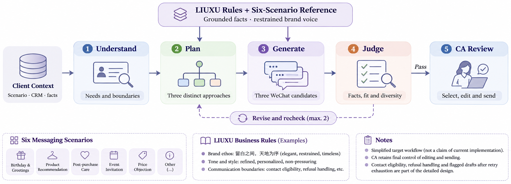
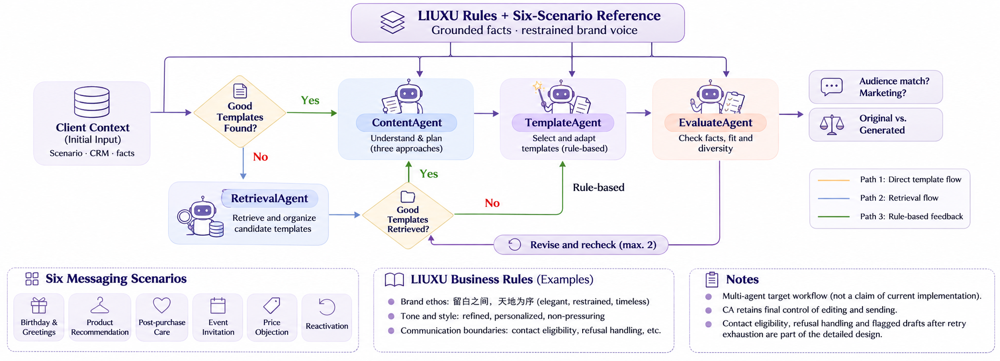
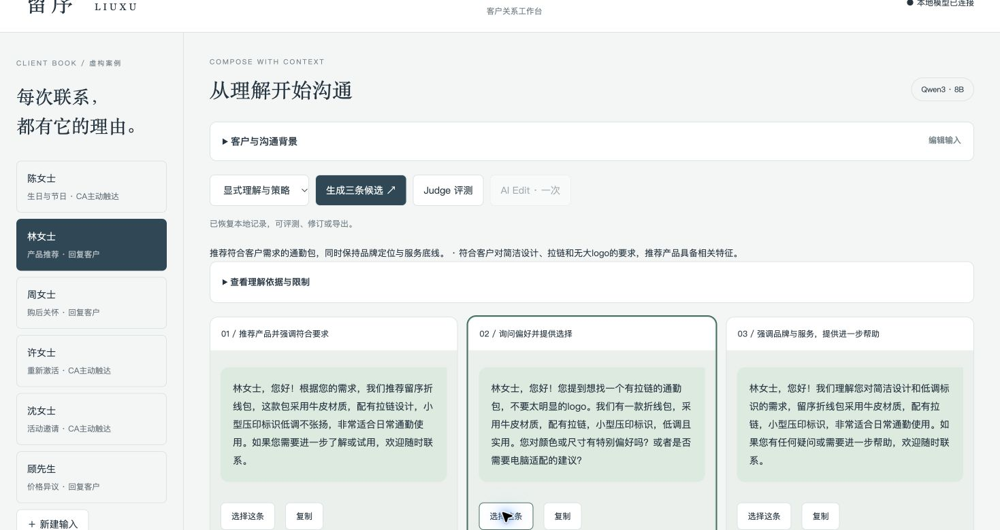

<div align="center">

# 留序 · LIUXU
### Brand-Grounded Client Messaging

**留白之间，天地为序。**
A relationship-first copilot for luxury Client Advisors.

[Final Outputs](deliverables/final-outputs/README.md) · [Workflow](docs/04_system_design.md) · [Results](evaluations/reports/project-results.md) · [Run Locally](#run-locally) · [Delivery Guide](deliverables/README.md)

</div>

---

LIUXU turns client context, conversation history, and verified product facts into three Chinese WeChat message candidates. Each candidate serves one communication objective through a different approach, giving the Client Advisor meaningful choice while respecting brand voice and contact boundaries.

**Six relationship moments:** birthday & festive greetings · product recommendation · post-purchase care · reactivation · event invitation · price objection.

## Start with the deliverable

| Project output | What to open |
| --- | --- |
| **Final Outputs — 50 cases** | [Final Excel](deliverables/final-outputs/LIUXU_test_results_50_FINAL.xlsx), with a readable case sheet and an original-data sheet |
| **150 output cells** | 147 client-message candidates and 3 clearly marked no-send handling notes for TC041 |
| **Runnable Client Studio** | Local Node.js + Ollama Qwen3:8b; generation, Judge, one AI edit, selection, copy, and JSON export |
| **Review evidence** | [Six-scenario user review](evaluations/runs/pilot-six-review/human-review-v1.md), [Judge comparison](evaluations/runs/pilot-judge-v1/findings.md), and [results report](evaluations/reports/project-results.md) |

The final workbook is the project's current messaging deliverable, prepared through AI-assisted drafting and case-by-case revision. Local Qwen experiments are a separate evidence track; the latest results will be supplemented under a `qwen-timeframexxx` name. The workbook does not claim an independently measured quality pass rate.

## Workflow



**Understand → Plan → Generate → Judge → CA Review**

Client context and LIUXU rules guide understanding and planning. Three approaches lead to three candidate messages; checks consider facts, context, and diversity. The CA retains the final editing and sending decision.

This is the primary product overview. In the prototype, understanding, planning, and generation share one structured model call. Judge is a separate, manually triggered call; one AI edit can be followed by re-evaluation. Independent planning and automatic bounded quality revision remain engineering work.

<details>
<summary><strong>Next direction: a multi-agent workflow</strong></summary>



The next design separates ContentAgent, RetrievalAgent, TemplateAgent, and EvaluateAgent responsibilities. Retrieval and template selection need versioned evidence, contact-eligibility checks, and validation against the direct baseline before adoption.

</details>

## Client Studio



The workspace brings fictional client context, constraints, conversation, and product information into one view. Advisors compare candidates, inspect Judge findings, request one revision, and choose a message.

The screenshot records an early prototype run. Its messages remain development evidence; the current final writing examples are in the workbook.

## Results and lessons

- **A complete case collection:** 50 cases across six scenarios, two aligned Excel sheets, the original eight-column schema, and preserved source information.
- **A concrete boundary decision:** TC041 restricts contact to craft information. Its three output cells explain why the advisor should withhold an event invitation.
- **Traceable improvements:** 10 output cells revised during final review, covering product comparisons, unsupported detail, service timing, contact permission, and natural expression.
- **Useful evaluation findings:** the pilot exposed irrelevant birthday personalization, generic reactivation, salutation errors, and Judge false positives or missed issues. [Read the evidence →](evaluations/reports/project-results.md)

Technical completeness and business quality are reported separately. Sales uplift, calibrated accuracy, and superiority over a baseline have not been measured.

## Run locally

Prerequisites: **Node.js 22+**, **Python 3** for artifact checks, and **Ollama** with `qwen3:8b`. The app uses Node's built-in modules; no npm installation is required.

```bash
git clone https://github.com/itsyiyang/artefact-clienteling-copilot.git
cd artefact-clienteling-copilot
ollama pull qwen3:8b
# Ensure Ollama is running, then:
npm start
```

Open **http://127.0.0.1:3210**. The app and inference stay local. Initial model download requires network access; inference speed depends on the machine.

```bash
npm test
python3 deliverables/final-outputs/verify_delivery.py
```

Additional tools: [customer simulation](docs/customer-agent.md), [input assembly](evaluations/assembled/README.md), and [batch reproduction](docs/fifty-local-run.md). The batch prompt is versioned separately from the Studio runtime prompt.

## Explore the project

| Area | Contents |
| --- | --- |
| [Final delivery](deliverables/README.md) | Workbook, verification, and A–E completion map |
| [Business & voice](rules.md) | Brand policy; [six-scenario messaging reference](docs/clienteling_messaging_reference.md) |
| [System design](docs/04_system_design.md) | Workflow, implementation, and multi-agent direction |
| [Evaluation](evaluations/README.md) | Cases, frozen runs, review evidence, methodology, and defects |
| [Roadmap](TASKS.md) | Completed capabilities and remaining work |
| [Development record](docs/work_log.md) | Decisions, changes, and evidence; [ADRs](docs/decisions/) |

## Next milestones

1. Independently review the final outputs and complete submission evidence.
2. Add the latest Qwen results under `qwen-timeframexxx`.
3. Calibrate Judge against user labels, including quote validity and contact boundaries.
4. Compare direct generation, independent planning, and bounded revision.
5. Implement and evaluate the multi-agent design.

All clients, histories, products, and events are fictional. The repository remains private; confidential challenge source documents are excluded. See the [delivery guide](deliverables/README.md) before external submission.

Local synchronization and presentation references: [repository guide](docs/repository-guide.md).
